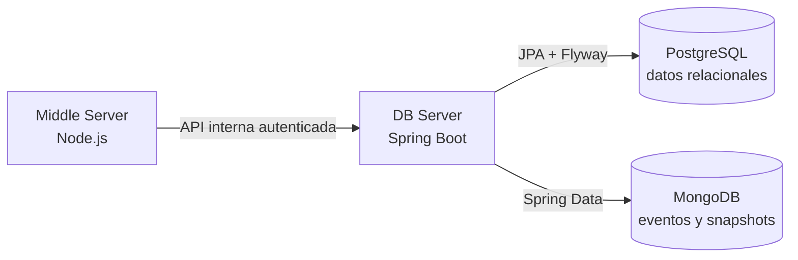

<div align="center">

# 💾 Viking Clan Wars · DB Server

### La memoria de cada reino.

**Persistencia, integridad de datos y analítica para las partidas.**

[](https://openjdk.org/)
[](https://spring.io/projects/spring-boot)
[](https://www.postgresql.org/)
[](https://www.mongodb.com/)

[Proyecto completo](https://github.com/agb4455/tfm) · [Motor de juego](https://github.com/agb4455/ProyectoIntermodularDamServidorIntermedio) · [Frontend](https://github.com/agb4455/ProyectoIntermodularDamFrontend)

</div>

---

## 🏛️ La memoria del reino

El **DB Server** es la capa de persistencia de Viking Clan Wars. Expone una API interna utilizada por el Middle Server, conserva usuarios, personajes y partidas, y almacena información de analítica. No está pensado como API pública para el navegador.

## 🧭 Arquitectura



## 🗄️ Responsabilidades

- Persistencia relacional de usuarios, personajes, partidas y participantes en PostgreSQL.
- Migraciones de esquema con Flyway.
- Registro y consulta de eventos y snapshots de analítica en MongoDB.
- Endpoints internos para autenticación, perfiles, partidas, estadísticas y administración.
- Validación de datos y control de acceso de las peticiones entre servicios.

## 🛠️ Tecnologías

Java 25 · Spring Boot 4 · Spring Web · Spring Security · Spring Data JPA · Spring Data MongoDB · PostgreSQL · Flyway · Testcontainers · Maven Wrapper

## 🚀 Desarrollo local

### Requisitos

- Java 25
- Docker disponible para levantar bases de datos o ejecutar tests de integración con Testcontainers
- PostgreSQL y MongoDB accesibles

### Configurar bases de datos

La aplicación requiere conexión a **ambas** bases de datos. Para levantar el entorno completo, se recomienda usar el [orquestador](https://github.com/agb4455/tfm). También puedes iniciar PostgreSQL y MongoDB por separado y definir las variables de entorno antes de arrancar la aplicación.

En `application.yml` son obligatorias las variables `POSTGRES_URL`, `POSTGRES_USER`, `POSTGRES_PASSWORD`, `MONGODB_URL` y `DB_HANDSHAKE_SECRET`. `PORT` usa `8080` por defecto; `MONGODB_DB_NAME` y `HANDSHAKE_TOKEN_TTL_HOURS` tienen valores predeterminados.

> El archivo `.env.example` contiene valores pensados como referencia de desarrollo en contenedores. Ajusta las URLs para tu entorno y reemplaza cualquier secreto de ejemplo. No publiques credenciales reales.

### Compilar, probar y ejecutar

```bash
./mvnw clean verify
./mvnw spring-boot:run
```

En Windows puedes usar `mvnw.cmd` en lugar de `./mvnw`. El servidor escucha en `http://localhost:8080` por defecto. Flyway aplica las migraciones al iniciar.

## 🧪 Pruebas

```bash
./mvnw test
```

La suite incluye tests unitarios y de integración. Algunos tests de integración usan Testcontainers y necesitan que Docker esté disponible.

## 🗂️ Mapa del código

```text
src/main/java/com/tfm/db_back/
├── api/             # Controladores REST y DTOs
├── config/          # Configuración de Spring, Mongo y seguridad
├── domain/
│   ├── exception/   # Excepciones de dominio
│   ├── model/       # Entidades y modelos
│   ├── repository/  # Repositorios de persistencia
│   └── service/     # Casos de uso y lógica de servicio
├── infrastructure/
│   └── mongodb/     # Documentos y repositorios analíticos
└── security/        # Filtro de autenticación interna

src/main/resources/db/migration/  # Migraciones Flyway
src/test/                         # Tests unitarios e integración
```

## 🔐 Integración y seguridad

El servicio usa un handshake firmado entre el Middle Server y el DB Server. Configura el mismo `DB_HANDSHAKE_SECRET` en ambos servicios. Mantén el DB Server y sus bases de datos dentro de la red privada de Docker; en el Compose del orquestador, el puerto `8080` solo se publica en el perfil de desarrollo.

## 🔗 Ecosistema

- [Orquestador y despliegue](https://github.com/agb4455/tfm)
- [Middle Server — motor de juego](https://github.com/agb4455/ProyectoIntermodularDamServidorIntermedio)
- [Frontend Angular](https://github.com/agb4455/ProyectoIntermodularDamFrontend)

## 📄 Licencia

Consulta [`LICENSE`](./LICENSE) para las condiciones de uso del proyecto.

<div align="center">

**Cada batalla deja huella. Aquí es donde se conserva.**

</div>
